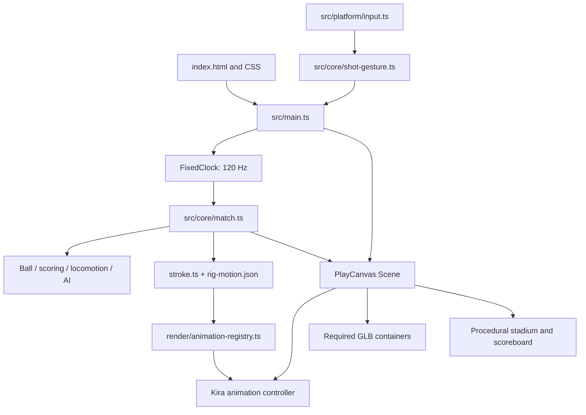

> Historical architecture setup snapshot, before GOAL 008. For GOAL 009 use baseline `f7fdda3e75a1d93b053da2e5ad941618547793da`, `docs/GOAL-008.md`, and current source. The original report is retained as history.

# Centre Court architecture

Discovery: 2026-10-27 UTC, `kalikeefbiz/Centre-Court`, `main` commit
`152c72c0384a491b978769e084ba19f57bca1fb5`. This is the source snapshot preserved
by the infrastructure GOAL. See [PROJECT_BASELINE](PROJECT_BASELINE.md) for acceptance limits.

## Confirmed stack and structure

| Area | Implementation / evidence |
| --- | --- |
| Rendering engine | PlayCanvas `pc.Application` in `src/render/scene.ts`; dependency `^2.20.0`, lockfile **2.23.3** |
| Language / build | Strict TypeScript **5.9.3**, Vite **7.3.7**, native ES modules; ES2022 build target |
| UI | HTML in `index.html`, CSS in `src/style.css`, DOM state/events in `src/main.ts`; no React framework |
| Fonts | Bundled `@fontsource/barlow` and `barlow-condensed`; licensing in `public/licenses/` |
| Gameplay | Plain TypeScript `src/core/`, authoritative `Match`, `Ball`, `Score`, seeded AI and shared velocity locomotion |
| Input / lifecycle | `src/platform/input.ts`, shared `ShotGesture`, browser lifecycle handling in `main.ts` |
| Presentation | `src/render/` owns character/ball containers, animations, camera presentation and procedural stadium |
| Diagnostics | `src/dev/`; tools dynamically imported only for `?dev=1`; read-only `window.centreCourt.snapshot()` for `?debug` or developer mode |
| Tests | Vitest **3.2.7** (`tests/**/*.test.ts`); Playwright **1.64.1** (`tests/browser/`) |
| Offline / server | Static browser application; no backend/service worker implementation found in this snapshot |

Versions above are resolved from `package-lock.json`, not package range guesses.
CI uses Node 22. Vite's resolved engine requires Node `^20.19.0 || >=22.12.0`;
use a supported Node 22 release to match CI.

## Runtime dependency map

Core gameplay has a deliberate dependency on the shared animation registry and
sampled rig motion. It is not wholly independent of presentation calibration.
Changes to clip markers, rig, racket socket, scale or sampled motion require
gameplay and graphics coordination. `src/main.ts`, `index.html` IDs and input
ownership form another shared contract. One owner edits each shared file.

`Scene` consumes simulation state; it does not own movement or scoring.
The simulation runs at 1/120 s; rendered updates use a bounded delta. See
[GAMEPLAY_SYSTEMS](GAMEPLAY_SYSTEMS.md) for rules and dependencies.
Required asset readiness gates match start; see [ASSET_PIPELINE](ASSET_PIPELINE.md).

## Build, verification and deployment

- `npm ci` installs the locked dependencies. `npm run build` runs `tsc --noEmit`
  then Vite; `npm test` runs Vitest. `npm run check` adds the browser suite.
- `vite.config.ts` uses `base: './'` for GitHub Pages, reads Git `HEAD` for
  `__BUILD_ID__`, and hashes the selected Kira, racket and ball for
  `__KIRA_ASSET_REVISION__`. Build/tests therefore require those local binaries
  and a Git checkout. Build emits `dist/release.json`, labelled `GOAL-007`.
- `public/` is copied into the static build, including uploaded characters and
  historical verification artifacts. Being present in `dist` does not mean an
  asset is requested by gameplay. Root `assets/` retains source uploads and is
  distinct from runtime `public/assets/`.
- Playwright previews `dist` on port 4173, serially with one worker. Projects are
  `desktop-chromium` (SwiftShader flags) and `mobile-webkit` (iPhone 13 viewport,
  device scale factor 1). These are desktop/Linux tests, not physical phones.
- `.github/workflows/pages.yml` verifies pushes to main, PRs and manual requests;
  normal verification installs dependencies, runs unit tests, builds, installs
  browser/OS dependencies and runs browser tests. Main non-PR runs upload Pages
  artifacts and deploy through the `github-pages` environment.
- Existing manual `verified_kira` mode checks out the pinned `d3e0c5e...` commit
  and skips fresh unit/browser checks. It is a historical publication path,
  not acceptance of the current main tree. This GOAL does not modify or invoke it.

GitHub run [40447214792](https://github.com/kalikeefbiz/Centre-Court/actions/runs/40447214792)
reported success for the discovery commit. This is remote historical CI evidence;
fresh local checks are recorded in [the infrastructure report](MULTI_AGENT_REPORT.md).

## Boundaries and unknowns

The repository tree (339 entries), source subsystem map, all 58 main-history
commits, configuration, test inventory, goal reports and release metadata were
surveyed. No existing `AGENTS.md`, `.codex/` or role configuration was present in
the discovery tree or its main history. Existing docs and workflows are preserved.

No owner approval of every current feature, physical-device compatibility,
current live Pages content, unlisted branches, or Nova's internal rig can be
inferred from this inspection. These require direct evidence when relevant.
